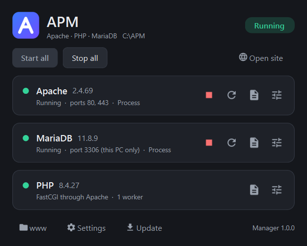
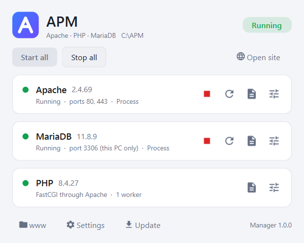
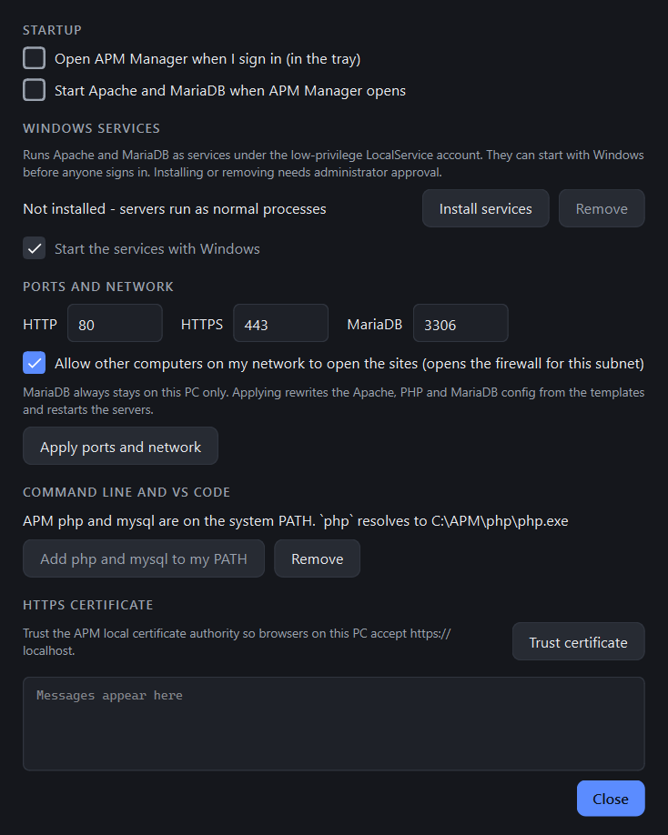
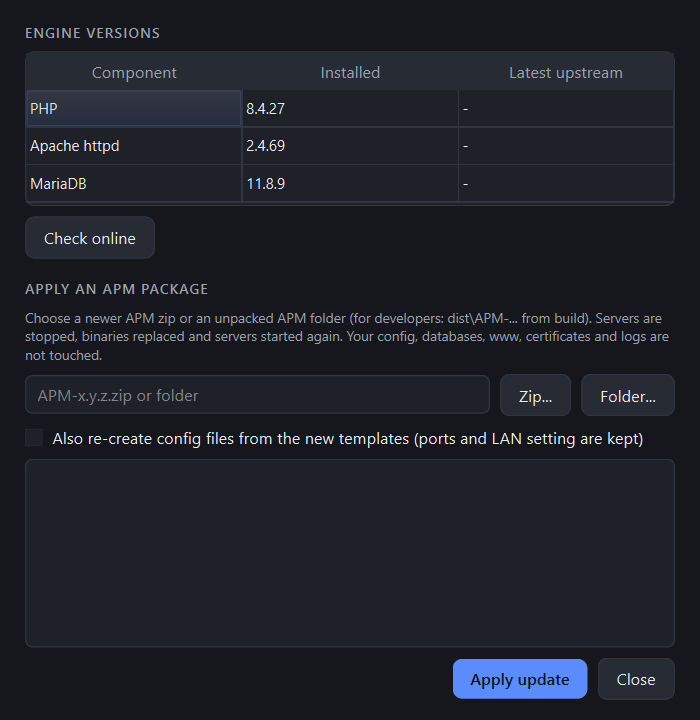

# APM - Apache + PHP + MariaDB for Windows, built from source

[ภาษาไทย](README.th.md) · [Build guide (EN)](HOWTO-BUILD.en.md) · [คู่มือ build (TH)](HOWTO-BUILD.md)

APM is a portable XAMPP-style web stack for Windows x64. Every engine is **compiled from upstream source**, so a security release can be rebuilt and shipped the same day. You unzip it anywhere and run it. A small tray app (APM Manager) controls everything.

| Component | Release 1.0.0 | Notes |
|---|---|---|
| Apache httpd | 2.4.69 | OpenSSL 3.5 LTS, HTTP/2, brotli, mod_fcgid |
| PHP | 8.4.27 NTS x64 | latest 8.4 security release (2026-10-21), OPcache + JIT |
| MariaDB | 11.8.9 LTS | supported until 2030 |
| ImageMagick | 7.1.2-34 | for the imagick extension |
| APM Manager | 1.0.0 | Qt 6, light/dark |

<p>
  
  
</p>

## Why

XAMPP ships updates slowly. The machine this project started on still had PHP 8.2.12 (2023), Apache 2.4.58 and an end-of-life MariaDB 10.4. Each of these has security fixes that landed upstream long ago.

APM pins every version in one file, [versions.json](versions.json). Bump a version and run `build.cmd`, and you get a new zip. The extension and module set matches a real Linux production server, so code that works on APM works there.

## Use it (portable)

1. Download `APM-<version>-win64.zip` from [Releases](../../releases) and check the `.sha256`.
2. Unzip it anywhere, e.g. `C:\APM` or `D:\Tools\APM`. Paths with spaces or brackets work.
3. Run `manager\APMManager.exe`. On first run it:
   - picks free ports (80/443/3306, falling back to 8080/8443/3307),
   - writes the config from `templates\`,
   - creates a local HTTPS certificate,
   - creates an empty MariaDB database (`root`, no password, this PC only).
4. Click **Start all**, then **Open site**. Your sites go in `www\default\`.

Nothing has to be installed. The VC++ runtime ships inside the zip. Nothing is written to the registry unless you turn on a feature that needs it (sign-in start, services, PATH).

**Moving the folder:** move or copy it whenever you like. The Manager notices, re-creates the config with the same ports and keeps the database.

## APM Manager

| Feature | What it does |
|---|---|
| Control | Start, stop and restart Apache and MariaDB (Apache restarts gracefully). Open the error logs and config files. Shows versions, ports and the number of PHP workers. |
| Tray | Closing or minimising sends it to the tray. The icon colour shows the status. The right-click menu has Start/Stop/Open site. |
| Auto start | Open the Manager at sign-in, start the servers when it opens, or install **Windows services** that start at boot (one UAC prompt). |
| Two modes | Without services the servers run as normal processes, with no admin needed. Services run as the low-privilege `LocalService` account, and the signed-in user can start and stop them without elevation. |
| Ports and LAN | Change ports, or let other PCs on your subnet open the sites. The firewall rule is limited to `httpd.exe` and `LocalSubnet`. MariaDB stays on 127.0.0.1. |
| PATH for VS Code | Puts APM's `php` and `mysql` on PATH. It edits the registry value raw as `REG_EXPAND_SZ`, so `%SystemRoot%` entries are not broken. |
| HTTPS | Trusts the APM local CA, so `https://localhost` shows no warning. |
| Updates | **Check for updates** reads this repo's GitHub Releases, downloads the zip and verifies its sha256. It then stops the servers, replaces the binaries and starts them again. Config, databases, `www`, `ssl` and logs are never touched. Installing from a zip or folder (offline) and comparing the engines with upstream are also available. |

<p>
  
  
</p>

### Command line

```
manager\APMManager.exe --cli status
manager\APMManager.exe --cli start|stop|restart [apache|mariadb|all]
manager\APMManager.exe --setup [--http 80 --https 443 --db 3306] [--lan] [--reset]
manager\APMManager.exe --tray
```

`--cli` uses the same engine as the window. Exit codes: `0` ok, `1` error (port in use, did not start), `2` not set up for this folder (or the folder was moved; run `--setup`).

## Folder layout

```
APM\
  manager\     APMManager.exe + Qt runtime
  apache\      httpd 2.4 (conf\httpd.conf is written by setup)
  php\         PHP 8.4 NTS + ext\ + ImageMagick (php.ini is written by setup)
  mariadb\     MariaDB 11.8 (my.ini is written by setup)
  templates\   config templates (httpd.conf, apm-ssl.conf, php.ini, my.ini, index.php)
  tools\       mkcert.php (certificates via PHP's openssl extension)
  www\         sites (default\ is the DocumentRoot)
  data\        MariaDB datadir
  ssl\         apm-ca.crt, localhost.crt, cacert.pem (Mozilla CA bundle)
  logs\ tmp\
  apm.json     setup state (root, ports, lan)
  licenses\    third-party licenses
```

## PHP extensions

`bcmath calendar ctype curl date dom exif FFI fileinfo filter ftp gd(webp, avif, jpeg, png, freetype) gettext hash iconv igbinary imagick intl json libxml mbstring mysqli mysqlnd openssl pcre(JIT) PDO pdo_mysql pdo_sqlite Phar random redis(+igbinary, session) Reflection session shmop SimpleXML soap sockets sodium SPL sqlite3 standard tokenizer xml xmlreader xmlwriter xsl Zend OPcache zip zlib`

This is the same set as the Linux production server, minus `posix sysvmsg sysvsem sysvshm`, which do not exist on Windows.

## Security

- MariaDB listens on `127.0.0.1` only, and `root` has no password (local dev). Set a password before exposing it.
- `phpinfo()` on the start page and `/server-status` answer only this PC. `.env`, `.git` and `.ht*` are denied.
- TLS 1.2/1.3 only.
- Services run as `NT AUTHORITY\LocalService`, never LocalSystem.
- Every download is sha256-checked ([versions.json](versions.json), [versions.lock.json](versions.lock.json)).
- The repo is guarded against leaking secrets:
  - [scripts/check-leaks.ps1](scripts/check-leaks.ps1) runs as a pre-commit hook (`git config core.hooksPath .githooks`).
  - [.github/workflows/security.yml](.github/workflows/security.yml) runs it plus gitleaks on every push.
  - Private terms live in a gitignored `private/leak-terms.txt`.

## Build from source

The step-by-step guide covers tools, every command and its real output, and every problem hit so far with its fix: **[HOWTO-BUILD.en.md](HOWTO-BUILD.en.md)** (English) / **[HOWTO-BUILD.md](HOWTO-BUILD.md)** (ไทย).

```
build.cmd     :: fetch -> vcpkg libs -> Apache -> MariaDB -> ImageMagick -> PHP -> Manager -> dist\APM-<ver>-win64.zip
deploy.cmd    :: install stage\ into C:\APM on the build machine
```

CI: pushing a tag `v*` makes [.github/workflows/release.yml](.github/workflows/release.yml) do three things:
1. build the whole stack on a Windows runner,
2. smoke-test the zip (setup, start, request a page through PHP + MariaDB, stop),
3. attach the zip to the GitHub Release.

## Versioning

`<version> build <n> (<commit>, <date>)`, e.g. `1.0.0 build 3 (7a106aa, 2026-10-22)`. Here `build` is the git commit count, and `-dirty` marks a build made from uncommitted changes. You can see it in the Manager's About window, in the exe's Properties and in the zip's README.txt.

## Credit

Designed and built by **ChonLaWan**:
- [wanpean@gmail.com](mailto:wanpean@gmail.com)
- [wanpean.com](https://wanpean.com)
- [github.com/ChonLaWan/APM-Server](https://github.com/ChonLaWan/APM-Server)

Developed with Claude Code in VS Code.

## License

The scripts and APM Manager in this repo are **MIT + Commons Clause** ([LICENSE](LICENSE)):
- Free to use, modify and share, at home or at work.
- **Selling** it, or a paid product or service whose value comes mainly from it, needs a commercial license. Contact [wanpean@gmail.com](mailto:wanpean@gmail.com).

This makes the repo source-available rather than OSI open source. The bundled binaries keep their own licenses: Apache-2.0, PHP-3.01, GPL-2.0 (MariaDB), the ImageMagick License, and LGPL-3.0 (Qt, dynamically linked). All of them are in `licenses\` inside the zip. Sources for the GPL/LGPL parts are the upstream URLs in [versions.json](versions.json), rebuildable with the scripts in this repo.
